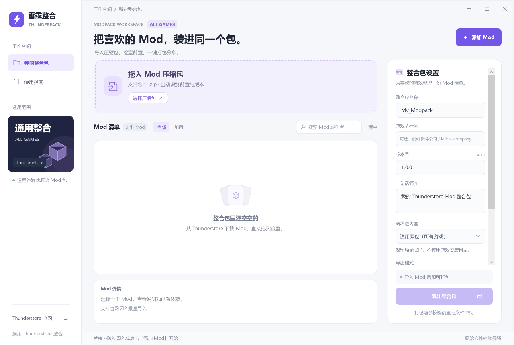

# ThunderPack 雷霆整合包

一个中文 Windows 桌面工具：导入从 [Thunderstore](https://thunderstore.io/) 下载的 Mod ZIP，检查前置依赖，再导出可分享的整合包。游戏名称可自由填写，默认不限定游戏或加载器。

[下载最新 Windows 版本](https://github.com/LYHqwq123/ThunderPack/releases/latest) · [发布记录](https://github.com/LYHqwq123/ThunderPack/releases)



## 开始使用

1. 从上方发布页下载 `ThunderPack-Universal-Windows-x64.zip`，解压后双击 `ThunderPack/ThunderPack.exe`。运行需要 [.NET 10 Windows Desktop Runtime](https://dotnet.microsoft.com/download/dotnet/10.0)；分享程序时保留同目录全部文件。
2. 把官网 Mod ZIP 拖入窗口，或点击“添加 Mod”批量选择；也可将 ZIP 拖到程序图标上启动并导入。
3. 按需填写游戏名称或 Thunderstore 社区标识，例如 `riskofrain2`；留空时使用通用标签。
4. 补齐前置，填写整合包名称、版本和简介，然后选择导出格式。

保留官网下载名 `团队-Mod名称-版本.zip`。ZIP 内的 `manifest.json` 通常没有作者和所属游戏字段；程序不会仅凭这个清单判断所属游戏。如果压缩包被重命名，程序只会从唯一匹配的依赖声明恢复作者，无法确认时需要手动补充。原始 ZIP 和包内文件不会被执行。

## 导出格式与安装方式

| 选项 | 内容 | 使用方式 |
| --- | --- | --- |
| 离线整合包 · 通用原包（默认） | `mods/` 原始 ZIP、`pack.json` 及 SHA256、中文说明 | 适用于不同游戏和加载器的原包收集与分享；可拖回本程序重新编辑 |
| 离线整合包 · BepInEx 安装目录 | 通用包内容，以及按常见 Windows BepInEx 目录整理的 `INSTALL_FILES/` | 仅在确认目标游戏及所选 Mod 使用适用 BepInEx 加载器时选择 |
| Thunderstore 发布包 | 根目录 `manifest.json`、`README.md`、256 × 256 的 `icon.png` | 上传至对应游戏社区的 Modpacks 分类；管理器会联网下载依赖 |

**通用原包模式不会生成游戏安装目录。** 各游戏及加载器的安装结构不同，原包保留了作者提供的所有文件；安装时遵照对应 Mod 的说明。这个离线 ZIP 采用本程序格式，不能作为 r2modman / Thunderstore Manager 的 profile 文件直接导入。

Thunderstore 发布包只列出依赖，不包含第三方 Mod 二进制文件。程序不会自动上传，也不会验证你填写的社区标识是否存在。

## 可选的 BepInEx 安装目录

1. 确认目标游戏使用 Windows BepInEx，以及导入的是适合该游戏的加载器和 Mod。
2. 关闭游戏，备份原有加载器、配置和 Mod 文件。
3. 解压整合包，把 **`INSTALL_FILES` 文件夹里面的内容**复制到对应游戏的正确安装位置。
4. 按该游戏的 Mod 安装说明启动并验证。

程序识别常见 BepInEx 加载器包装目录，并整理 `plugins`、`config`、`patchers`、`core`、`monomod` 等路径。它不能替代每个游戏专用的安装规则；不确定时使用默认通用原包模式。未包含加载器时，目标游戏需要先安装适用加载器。MelonLoader 等其他加载器请使用通用原包模式。

## 前置检查的范围

- 采用**精确版本校验**，让导出的原始 ZIP 与声明一致。不同 Mod 对同一前置声明不同版本时会阻止导出；这是本工具的本地打包策略。
- 前置缺失、前置停用、同一 Mod 多个启用版本、未知作者均会提示。可从官网补齐对应前置；网络失败时仍可手动导入 ZIP。
- 游戏标签用于整理和说明，不会验证各 Mod 是否属于同一个游戏。请把不同游戏的 Mod 分开打包。
- 检查覆盖 ZIP、声明、SHA256 和可选安装文件冲突，不会运行游戏或验证 Mod 之间的运行、联机兼容性。
- 分享离线包前请确认各 Mod 的分发许可。

## 从源码构建

环境：Windows 10/11、.NET 10 SDK。项目没有第三方 NuGet 依赖，`NuGet.Config` 已清空联网源；本机须有对应 SDK 和 Windows Desktop targeting pack。

```powershell
./build.ps1
```

脚本先运行核心验证，再生成 `dist/ThunderPack/ThunderPack.exe`。输出是需要桌面运行库的发布目录，分享时保留整个文件夹。

只运行核心验证：

```powershell
$env:DOTNET_CLI_HOME = Join-Path $PWD '.build/dotnet-home'
$env:NUGET_PACKAGES = Join-Path $PWD '.build/nuget-packages'
$env:MSBuildEnableWorkloadResolver = 'false'
dotnet run --project tests/ThunderPack.Smoke --configuration Release -- $PWD
```

界面验证（需要 Windows 桌面会话）：

```powershell
dotnet run --project tests/ThunderPack.UiSmoke --configuration Release -- $PWD
```

验证覆盖通用原包、其他加载器包、自定义游戏标签、BepInEx 布局、依赖、SHA256 往返、危险 ZIP、下载缓存、取消、原文件保护和实际界面操作。合成 ZIP 位于 `artifacts/test-data/` 与 `artifacts/ui-check-state/`，仅供测试，不是真正的游戏 Mod。

`tests/ThunderPack.RealCheck` 另有一组真实官网下载 ZIP 的回归验证，仅在本地存在对应测试包时运行。此验证不启动游戏。

## 格式依据

- [Thunderstore 包格式与 manifest 字段](https://wiki.thunderstore.io/mods/creating-a-package)
- [不同加载器的包文件路由](https://wiki.thunderstore.io/mods/packaging-your-mods)
- [各游戏的管理器安装规则](https://github.com/thunderstore-io/ecosystem-schema/tree/master/games/data)
- [加载器根目录映射](https://github.com/thunderstore-io/ecosystem-schema/blob/master/games/misc/modloader-packages.yml)
- [r2modman 实际依赖解析策略](https://github.com/ebkr/r2modmanPlus/blob/develop/src/utils/DependencyUtils.ts)
- [r2modman profile 格式及限制](https://github.com/ebkr/r2modmanPlus/wiki/Profiles)
